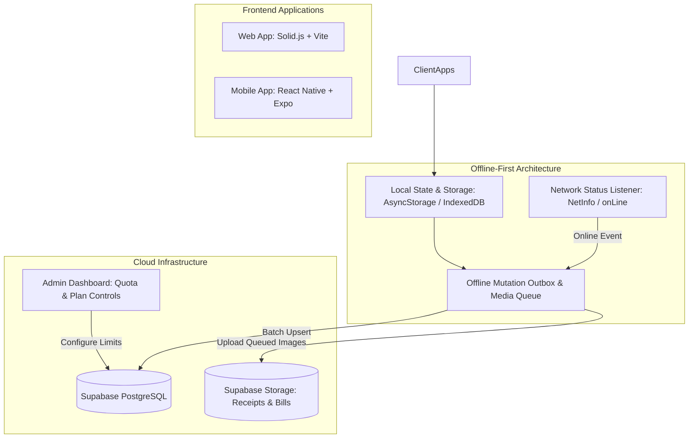

# Comprehensive System Improvement & Feature Implementation Plan
## BYAPAR (व्यापार) ERP / POS — Web & Mobile Ecosystem

---

### Executive Summary

This document provides a complete, architectural breakdown and step-by-step implementation plan for the 8 major improvements and new features requested for the **Byapar (व्यापार)** retail and wholesale ecosystem across **Web (`apps/web`)**, **Mobile (`apps/mobile`)**, **Admin (`apps/admin`)**, and **Core (`packages/core`)**.

---

## 1. Feature Breakdown & Scope Analysis

### Feature 1: Expense & Income Enhancements
*Platforms: Web & Mobile*

#### 1.1 Requirements
1. **Multi-Type Date Filtering**:
   - Filter presets: `Today`, `Yesterday`, `This Week`, `This Month`, `This Year`, `All Time`.
   - `Custom Date Range` picker: From Date (AD/BS) to To Date (AD/BS).
   - Dynamic KPI re-calculation: Total Expenses, Total Incomes, Net Balance based on active date filter.
2. **UI & UX Refinement**:
   - Fix visual issues, layout overflow, contrast in light/dark modes, and mobile touch targets.
   - Distinct badges for payment modes (`Cash`, `Fonepay QR`, `Bank Transfer`, `eSewa`, `Cheque`).
   - Clear empty states with contextual illustrations and quick add triggers.
3. **Edit Entry Capability**:
   - Ability to modify existing expense/income entries (Amount, Category, Date, Payment Mode, Payer/Recipient, Notes, Receipt Image).
   - Instant local update and sync to Supabase `expenses` / `incomes` tables.
4. **Custom Categories Management**:
   - Allow merchants to create, edit, color-code, and delete custom expense and income categories.
   - Dynamic category picker that merges default Kirana presets with user's custom categories.

---

### Feature 2: Customer Khata (Parties) Actions & Statement Report
*Platforms: Web & Mobile*

#### 2.1 Requirements
1. **Direct Phone Call**:
   - Clickable call button on party card/profile that opens native phone dialer (`tel:${party.phone}`).
   - Web: `<a href="tel:...">` or window navigation with formatted number.
   - Mobile: React Native `Linking.openURL('tel:' + phone)`.
2. **Auto-Filled Multi-Type Reminders**:
   - Direct "Set Reminder" action from party detail view.
   - Auto-filled title:
     - If Receivable: `"Payment reminder for [Customer Name] - Due: Rs. [Balance]"`
     - If Payable: `"Payment due to [Supplier Name] - Amount: Rs. [Balance]"`
   - Reminder fields: Date, Time (AM/PM), Reminder Type:
     - `Payment Reminder`
     - `Task Reminder`
     - `Event Reminder`
   - Reminder frequency (`Once`, `Daily`, `Weekly`, `Monthly`) and notes.
3. **Full Reminder Feature (Web & Mobile)**:
   - Dedicated screens/views for managing reminders.
   - Filter tabs: `Upcoming` (active/due) and `Completed` (marked done).
   - Mark complete, delete, edit, snooze, and direct WhatsApp trigger from reminder card.
4. **View Report (A4 Party Ledger Statement)**:
   - Comprehensive statement modal/screen for the selected customer/supplier.
   - Date range filters: `Today`, `Yesterday`, `This Week`, `This Month`, `This Year`, `All Time`, `Custom (From Date - To Date)`.
   - **A4 Layout Structure**:
     - Header: Shop Name, Address, Phone, PAN/VAT, Logo, and "BYAPAR" official branding watermark/badge.
     - Party Details: Customer/Supplier Name, Phone, Address, PAN/VAT, Account Type.
     - Report Metadata: Statement Period (`From [Date] To [Date]`) & Report Generated Timestamp (`YYYY-MM-DD HH:mm:ss`).
     - Executive Summary:
       - Total Money In (Payments Received / Liyo)
       - Total Money Out (Credit Given / Diyo)
       - Net Closing Balance (Due or Advance)
     - Full Transaction Table:
       - S.N., Date (AD & BS), Particulars/Notes, Debit (Diyo / Out), Credit (Liyo / In), Running Balance.
   - **Export & Share Actions**:
     - **Download PDF**: Formatted clean A4 PDF file.
     - **Print PDF**: Native print dialog with A4 print CSS / `expo-print`.
     - **Export Excel / CSV**: Clean CSV data download compatible with Excel.
     - **Share**: WhatsApp share / Web Share API / React Native Share with summary text + statement link/file.

---

### Feature 3: Business Notes & Daily Scratchpad
*Platforms: Web & Mobile*

#### 3.1 Requirements
1. **Dual-Platform Synchronized Notes**:
   - Web: Refine existing `NotebookView.tsx` with locked timestamps and category tags.
   - Mobile: Build complete `NotesScreen.tsx` with seamless navigation.
2. **Note Data Structure**:
   - `Heading / Title` (bold, searchable).
   - `Content` (multi-line text, checklists).
   - `Category / Tags` (Daily Accounts, Supplier Orders, Cheque to Clear, General, Custom).
   - `Color Themes` (Emerald, Amber, Rose, Blue, Purple).
   - `Locked Timestamp`: Creation date & time are immutable (`createdAt` timestamp locked at time of creation). Last edited timestamp tracked separately (`updatedAt`).
   - `Pin Note`: Pin critical tasks to the top.
3. **Offline & Cloud Sync**:
   - Auto-saved to local database instantly.
   - Background synchronized to Supabase table `business_notes`.

---

### Feature 4: Digital Business Card Studio
*Platforms: Web & Mobile*

#### 4.1 Requirements
1. **Dynamic Template Designs**:
   - **Classic Kirana Pro**: Clean traditional merchant card with trust seals, PAN number, and bold store name.
   - **Modern Gradient**: Sleek dark card with glassmorphism, gradient glow, and tech-forward typography.
   - **Royal Elegance**: Gold/amber luxury styling for boutiques, jewelers, and upscale retail.
   - **Minimalist Swiss**: High-contrast, clean monochrome typography.
   - **QR Pay Special**: Card featuring big, high-density Fonepay / Store QR code in center with merchant details for instant tabletop scan-to-pay.
2. **Dynamic Styling & Customization**:
   - Color palette switchers: Emerald Green, Royal Blue, Ruby Red, Sunset Amber, Midnight Black, Purple Velvet.
   - Orientation: Horizontal (classic landscape) & Vertical (mobile story/poster).
   - Customizable Fields: Store Name, Tagline, Owner Name, Phone 1, Phone 2 (WhatsApp), Address, PAN/VAT, Store QR Code, and Custom Promotional Text ("Free Home Delivery").
3. **Actions**:
   - **Download as Image**: High-resolution PNG image download (via HTML Canvas export in Web, ViewShot / SVG canvas export in Mobile).
   - **Share on WhatsApp**: One-tap share of card info and image directly to WhatsApp.

---

### Feature 5: Transaction Image / Receipt Attachments & Admin Quota Control
*Platforms: Web, Mobile & Admin*

#### 5.1 Requirements
1. **Universal Transaction Attachments**:
   - Add image attachment option (camera snapshot or gallery upload) across all transaction forms:
     - Income & Expense entries (`receiptUrl` / `receiptImage`)
     - Purchase invoices & Purchase returns (`billImageUrl`)
     - Customer Khata Credit (Diyo) & Payment (Liyo) records (`receiptImageUrl`)
     - Sales Invoices (`attachmentUrl`)
2. **Tiered Plan Quota Enforcement**:
   - Free Tier: Limited uploads (e.g., 5 uploads/month or max file size 1MB).
   - Starter Tier: 50 uploads/month.
   - Pro / Enterprise Tier: Unlimited uploads (-1).
   - Real-time client-side quota validation with clear warning and upgrade modal popup when limit is reached.
3. **Admin Control Panel (`apps/admin`)**:
   - In `SubscriptionsView.tsx` and `adminApi.ts`, add controls to:
     - Configure `monthly_image_upload_limit` per plan.
     - Configure `max_image_size_mb` per plan.
     - Toggle `enable_transaction_attachments` feature flag.

---

### Feature 6: Mobile App Lock (PIN & Biometric Security)
*Platform: Mobile Only*

#### 6.1 Requirements
1. **Dual-Factor Authentication**:
   - **4-Digit / 6-Digit Secure PIN**: User sets and confirms PIN.
   - **Biometric Authentication**: Fingerprint / Face ID integration.
2. **Cryptographic Security**:
   - PIN is salted and hashed using SHA-256 (`crypto-js`) before storage. Plaintext PIN is never saved.
   - Rate limiting: 5 failed attempts locks app for 30 seconds with countdown timer.
   - Recovery flow: Reset PIN using store account credentials.
3. **AppState Lifecycle Interception**:
   - Listens to React Native `AppState` changes.
   - Automatically engages lock screen when app moves to background or device is locked.
   - Configurable timeout: Immediately, after 1 minute, after 5 minutes.
   - Full-screen security barrier prevents interaction or preview until authenticated.

---

### Feature 7: Business Calculators & Financial Utilities Suite
*Platforms: Web & Mobile*

#### 7.1 Requirements
1. **EMI Calculator**:
   - Inputs: Loan Principal (Rs.), Annual Interest Rate (%), Loan Tenure (Months/Years).
   - Outputs: Monthly EMI, Total Interest Payable, Total Payment (Principal + Interest), Visual Amortization bar.
2. **Interest Calculator (Simple & Compound / Nepali Khata Mahinako Byaj)**:
   - Supports commercial bank rate (Annual %) and informal market/Kirana rate (Monthly %, e.g., 1.5% or 2% per month).
   - Date range calculator: computes exact number of days between two dates.
   - Modes: Simple Interest vs Compound Interest (Monthly, Quarterly, Semi-Annually, Annually).
   - Outputs: Total Interest, Total Amount, Daily equivalent interest.
3. **VAT / Tax & TDS Calculator**:
   - Dual Mode:
     - **Tax Exclusive**: Given Base Amount -> calculates 13% VAT and Gross Total.
     - **Tax Inclusive**: Given Gross Amount -> reverse calculates Taxable Base and 13% VAT component.
   - TDS presets: 1.5% (goods supply), 10% (rental/consultancy), 15% (royalties/services), and Custom %.
4. **Margin & Markup Calculator**:
   - Mode 1: Cost Price + Selling Price -> Profit Amount, Gross Margin (%), Markup (%).
   - Mode 2 (Target Margin): Cost Price + Desired Margin (%) -> Required Selling Price.
5. **Cash Denomination Counter & Change Calculator**:
   - Change calculation: Bill Total vs Cash Received -> Exact change to return.
   - Cash register counter: Counts quantity of Rs 1000, 500, 100, 50, 20, 10, 5 notes and calculates drawer total.

---

### Feature 8: Offline-First Architecture & Sync Outbox Engine
*Platforms: Web & Mobile*

#### 8.1 Requirements
1. **Zero-Latency Local Operation**:
   - Every transaction (POS sale, Khata entry, Expense, Income, Reminder, Note) writes directly to local storage (AsyncStorage in Mobile, LocalStore/IndexedDB in Web).
   - Full search, filter, and reporting functions operate 100% offline without network dependency.
2. **Offline Mutation Queue (Outbox)**:
   - When offline, every data mutation generates a timestamped queue event in `offline_sync_outbox`.
   - Action types: `CREATE`, `UPDATE`, `DELETE`, `UPLOAD_MEDIA`.
3. **Offline Image Upload Resilience**:
   - Images captured offline are saved to local persistent storage (File System URI or local Base64 cache) and tagged with `sync_status: 'pending'`.
   - When online connectivity is detected via `NetInfo` (mobile) or `navigator.onLine` (web):
     1. Background sync worker iterates through the media queue.
     2. Uploads images to Supabase Storage bucket (`receipts` / `bills`).
     3. Replaces local image pointers with public/signed cloud URLs.
     4. Synchronizes database rows in chronological order.
     5. Marks outbox items as `synced`.
4. **Visual Network Status Indicator**:
   - Subtle status badge in header:
     - 🟢 *Online & Synced*
     - 🟡 *Offline (Saved locally)*
     - 🔵 *Syncing X items...*

---

## 2. Architecture & Data Flow

---

## 3. Detailed Implementation Plan by Module

### Phase 1: Core Domain Models & Shared Utilities (`packages/core`)
- Update `packages/core/src/types/models.ts`:
  - Extend `Expense` & `Income` interfaces with `receiptImageUrl`, `customCategory`, `updatedAt`.
  - Extend `ReminderWithConfig` with `dueTime`, reminder types (`payment_reminder` | `task_reminder` | `event_reminder`).
  - Extend `Party` and `KhataEntry` with `receiptImageUrl`.
  - Add `BusinessNote` interface with locked `createdAt` and optional `color`, `isPinned`, `tags`.
  - Add `SubscriptionPlan` upload quota attributes: `monthly_image_upload_limit`, `max_image_size_mb`.
- Add mathematical utility functions for financial calculations in `@byapar/core`:
  - `calculateEmi(principal, annualRate, months)`
  - `calculateInterest(principal, rate, days, mode, frequency)`
  - `calculateTax(amount, taxRate, isInclusive)`
  - `calculateMargin(costPrice, sellingPrice)`

### Phase 2: Expense/Income Overhaul (Web & Mobile)
- **Web (`apps/web/src/components/views/ExpenseIncomeView.tsx`)**:
  - Add Date Filter toolbar: Pills for Today, Yesterday, This Week, This Month, This Year, All, Custom Range.
  - Implement Custom Range modal with date inputs.
  - Add Edit Modal: pre-fills existing record, updates `localDb`, and syncs.
  - Add Custom Category Manager: dynamic category creation with color picker.
  - Add Receipt Image upload with preview modal.
- **Mobile (`apps/mobile/src/screens/ExpenseIncomeScreen.tsx`)**:
  - Add Date Filter strip with horizontal scrolling pills + Date Range modal.
  - Add Edit button on transaction cards, triggering `ExpenseIncomeEditModal`.
  - Add custom category creator modal and storage persistence.
  - Integrate `expo-image-picker` for bill/receipt attachment.

### Phase 3: Parties / Khata Enhancements & A4 View Report
- **Phone Call**:
  - Add Call button on party details in `KhataView.tsx` (web) and `LedgerScreen.tsx` (mobile) using `tel:${party.phone}`.
- **Auto-Filled Multi-Type Reminders**:
  - Create `CreateReminderModal` in both web and mobile, auto-populating party name and current balance.
  - Select reminder type: Payment Reminder, Task Reminder, Event Reminder with time & date pickers.
- **Full Reminders Feature**:
  - Web: Update `RemindersView.tsx` with time selector, reminder types, and upcoming/completed tabs.
  - Mobile: Create `apps/mobile/src/screens/RemindersScreen.tsx` with full CRUD, notifications, and status tabs.
- **A4 View Report (Party Statement)**:
  - Create `PartyStatementModal` / `PartyReportView` in both web and mobile:
    - Date filtering: Today, Yesterday, This Week, This Month, All Time, Custom Range.
    - Financial KPI cards: Total In (Liyo), Total Out (Diyo), Net Balance.
    - Professional A4 statement preview with shop details, customer details, and timestamp.
    - Export tools:
      - **Download PDF**: Generates styled PDF.
      - **Print PDF**: Invokes browser print / `expo-print`.
      - **Excel/CSV Export**: Triggers CSV download.
      - **Share**: WhatsApp share with structured statement message and file link.

### Phase 4: Business Notes Feature (Web & Mobile)
- **Web (`NotebookView.tsx`)**:
  - Enhance note creation with locked timestamp display (`createdAt`).
  - Search, filter by category/color, pin notes, copy note.
- **Mobile (`apps/mobile/src/screens/NotesScreen.tsx`)**:
  - Build complete screen with note cards, color palettes, pin toggle, locked timestamp, and search.
  - Connect to `AppContext` (`notes`, `addNote`, `editNote`, `deleteNote`, `togglePinNote`).
  - Wire into navigation menu/drawer.

### Phase 5: Digital Business Card Studio (Web & Mobile)
- **Web (`apps/web/src/components/views/BusinessCardView.tsx`)**:
  - Design 5 distinct card templates (Classic Kirana, Modern Neon, Royal Gold, Minimalist, QR Pay).
  - Dynamic color theme switcher and custom field editor.
  - Download as image via HTML5 Canvas (`canvas.toDataURL('image/png')`).
  - Direct WhatsApp share trigger with pre-filled card information.
- **Mobile (`apps/mobile/src/screens/BusinessCardScreen.tsx`)**:
  - Interactive card preview with template selector and color chips.
  - Image export via SVG / Canvas / ViewShot.
  - WhatsApp share button opening WhatsApp with store details.

### Phase 6: Transaction Image Uploads & Admin Quota Controls
- **Client Upload Handlers**:
  - Attach images to Incomes, Expenses, Purchase bills, Khata entries, and Sales invoices.
  - Quota verification before upload: checks current month count against plan limit.
  - Show upgrade modal (`SubscriptionModal`) if limit reached.
- **Admin Configuration (`apps/admin/src/views/SubscriptionsView.tsx`)**:
  - Add input fields to Plan Configuration:
    - Monthly Image Upload Limit (`monthly_image_upload_limit`)
    - Max File Size in MB (`max_image_size_mb`)
    - Enable Transaction Images Toggle
  - Persist to Supabase `subscription_plans`.

### Phase 7: Mobile App Lock (PIN & Biometric Security)
- **Security Engine (`apps/mobile/src/services/appLockService.ts`)**:
  - PIN hashing: `SHA256(pin + salt)`.
  - Storage in AsyncStorage: `@byapar_app_lock_enabled`, `@byapar_app_lock_pin_hash`, `@byapar_biometrics_enabled`.
  - Failed attempts tracker with 30s lockout after 5 incorrect inputs.
- **UI & Lifecycle (`apps/mobile/src/components/security/AppLockModal.tsx`)**:
  - Keypad UI for 4-digit PIN with haptic feedback.
  - Biometric authentication trigger on mount.
  - `AppState` listener in `AppNavigator.tsx`: automatically presents lock screen on app foreground.
- **Settings Screen Integration**:
  - Security section in `SettingsScreen.tsx` to set/change PIN and toggle biometrics.

### Phase 8: Financial Calculators & Business Utilities
- **Web (`apps/web/src/components/views/UtilitiesView.tsx`)**:
  - Tabbed interface for EMI, Interest, VAT/Tax, Margin/Markup, and Cash Counter.
  - Interactive sliders, real-time recalculation, and printable result breakdown.
- **Mobile (`apps/mobile/src/screens/UtilitiesScreen.tsx`)**:
  - Touch-friendly calculators with segmented tab control and quick denomination counters.
  - Accessible from bottom navigation / more tools menu.

### Phase 9: Offline Mode & Sync Outbox Engine
- **Outbox Architecture (`offlineSyncManager.ts` & `syncQueue.ts`)**:
  - Persistent queue `@byapar_offline_outbox`.
  - Queue item structure: `{ id, action, table, data, mediaUri, timestamp, status }`.
- **Media Upload Queue**:
  - Stores local image URI/Base64 when offline.
  - When connection is restored, uploads to Supabase Storage, updates remote DB row with public URL, and marks synced.
- **Network Status Banner**:
  - Visual status pill in web header and mobile AppHeader showing real-time connectivity and pending sync count.

---

## 4. Verification & Testing Matrix

| Feature Module | Verification Test Cases | Expected Outcome |
|---|---|---|
| **1. Expense/Income** | Filter by This Month, Year, Custom Date; Edit an existing entry; Add custom category | List and KPIs filter instantly; edits persist locally and in cloud; custom categories appear in dropdown |
| **2. Khata & Report** | Tap phone icon; create reminder for customer; open A4 statement; click PDF/Excel | Phone dialer opens; reminder is pre-filled with customer details; statement shows A4 format with all transactions and branding |
| **3. Notes** | Create note; check date; edit content; pin to top; reload | Created timestamp is locked; pinned notes stay on top; persists across app reloads |
| **4. Business Card** | Select template; change color; click download image; click WhatsApp share | Card renders with custom theme; high-res image is downloaded; WhatsApp opens with formatted card text |
| **5. Image Uploads & Admin** | Attach receipt; test free plan limit; change limit in Admin panel | Image attaches to transaction; limit warning triggers when quota exceeded; admin controls update plan rules |
| **6. App Lock** | Set 4-digit PIN; background the app; reopen app; enter wrong PIN 5 times | Lock screen blocks UI; correct PIN unlocks; 30s lockout after 5 failed attempts |
| **7. Utilities** | Calculate EMI for 5L loan; calculate 13% tax inclusive of Rs 1130; calculate monthly interest | EMI matches banking formula; Rs 1130 yields Rs 1000 base + Rs 130 VAT; interest matches exact days |
| **8. Offline Sync** | Turn off network; add khata entry with photo; turn network on | Entry saves locally with image; sync outbox processes upload when online; data appears in cloud |

---
*Byapar Technical Architecture Team — Implementation Ready*
